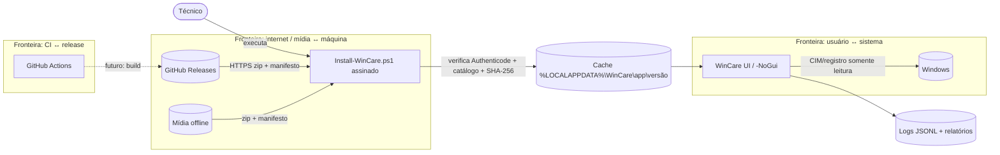

# SECURITY-NOTES — WinCare Enterprise

> Registro da mb-sec-gate. Sem segredos, tokens ou dados pessoais neste arquivo.

| Campo | Valor |
|---|---|
| Nível de risco | **R2** — sem backend, contas ou dados de terceiros (seria R0/R1), mas é ferramenta local com potencial de rodar como administrador em parque corporativo e com cadeia de distribuição própria: comprometer o pacote atinge muitas máquinas. Subido um nível por precaução. O baseline sugeriu R3 por palavras-chave ("payments" no YAML de CI, "health" em textos de alerta) — falso positivo. |
| Escopo | Repositório local `Projects/wincare-enterprise` (v0.1.0). Sem URL, sem release, sem repositório remoto. |
| Onde roda | Estação Windows do técnico/usuário (local). CI no GitHub Actions quando publicado. |
| Dados tratados | Inventário técnico da própria máquina (edição, hardware, processos, comandos de inicialização, nome do computador/domínio). Fica local (`%LOCALAPPDATA%\WinCare`). Nada é enviado a terceiros. Relatórios podem conter nome de máquina/domínio/usuário em itens de inicialização — tratar como dado interno da organização. |
| Responsável | Mantenedor do projeto · contato de incidente: a definir antes da publicação (GitHub Security Advisories) |
| Última revisão | 2026-11-16 · próxima: antes do primeiro release assinado (F6) ou ao adicionar a primeira ação que modifica o sistema (F3) |

## Diagrama de fluxo de dados

## Ameaças (registro)
| ID | Ameaça | Ativo | P | I | Nota | Tratamento | Controle / evidência | Dono | Status |
|---|---|---|---|---|---|---|---|---|---|
| T1 | Pacote adulterado (servidor, MITM, mídia) executa código como admin | Máquinas do parque | 3 | 5 | 15 | Mitigar | Authenticode + catálogo assinado + impressões digitais fixadas + rejeição de arquivo extra; `tests/Bootstrap.Tests.ps1` | Mantenedor | Mitigado (mocks); validar no Windows |
| T2 | Zip com caminho malicioso (zip slip) grava fora da pasta | Máquina | 2 | 4 | 8 | Mitigar | `Expand-WcbZipSafe` + 5 casos de teste | Mantenedor | Mitigado |
| T3 | Usuário contorna política com `iex`/`Bypass` copiados de tutorial | Política corporativa | 3 | 4 | 12 | Evitar | Sem `iex`/Bypass no código (teste AST); docs explicam o porquê | Mantenedor | Mitigado |
| T4 | Ação futura desativa proteção (Defender, Firewall…) | Postura de segurança | 2 | 5 | 10 | Evitar | Recursos protegidos rejeitados no carregamento do catálogo; teste | Mantenedor | Mitigado |
| T5 | XSS no relatório HTML via nome de processo/rótulo | Quem abre o relatório | 3 | 3 | 9 | Mitigar | HtmlEncode em todo valor + CSP `default-src 'none'`; teste | Mantenedor | Mitigado |
| T6 | Cache adulterado após verificação (outro processo do usuário) | Máquina | 2 | 4 | 8 | Mitigar | Reverificação a cada execução | Mantenedor | Mitigado (mocks) |
| T7 | Chave de assinatura vazada → pacote malicioso "válido" | Todo o parque | 2 | 5 | 10 | Mitigar | Pendente F6: chave em HSM/token ou Trusted Signing, sem chave no CI, revogação + troca de thumbprint documentadas | Mantenedor | **Aberto (F6)** |
| T8 | Ação de CI comprometida (supply chain) | Release | 2 | 4 | 8 | Mitigar | Pendente F6: fixar actions por SHA, `permissions: contents: read` (feito), assinatura fora do CI | Mantenedor | Parcial |
| T9 | Relatório com dados internos compartilhado indevidamente | Info da organização | 3 | 2 | 6 | Aceitar/avisar | Relatórios ficam locais; aviso na página de relatórios | Mantenedor | Aceito |

## Baseline
`sec_baseline.py` em 2026-11-16: **0 BLOCKER · 0 AVISO · 1 INFO** (sem manifesto de dependências — esperado: projeto sem dependências de runtime).

## Plano de segurança
| # | Skill | Escopo | Bloqueia? | Status | Resultado |
|---|---|---|---|---|---|
| 1 | mb-appsec | Scripts PowerShell, bootstrapper, cadeia de suprimentos | Antes do 1º release | Pendente (F6) | — |
| 2 | mb-infra-security | GitHub Actions, assinatura, publicação | Antes do 1º release | Pendente (F6) | — |
| — | mb-api-security, mb-data-protection, mb-ai-security, mb-phishing-defense | Não se aplicam (sem API, sem dado pessoal enviado, sem IA, sem domínio de e-mail) | — | N/A | — |

## Gate de liberação
Decisão: **LIBERADO COM RESSALVAS para uso local/laboratório (v0.1.0, somente leitura). BLOQUEADO para publicação/release** até T7/T8 e o plano 1–2 — 2026-11-16.

## Exceções aceitas
| Item | Motivo | Controle compensatório | Dono | Expira em |
|---|---|---|---|---|
| Kit de validação sem assinatura | Ainda não há certificado | Só VM/laboratório; SHA-256 por canal separado; bootstrapper rejeita o kit | Mantenedor | Primeiro release assinado |

## Histórico
- 2026-11-16: gate inicial (F1/F2).
